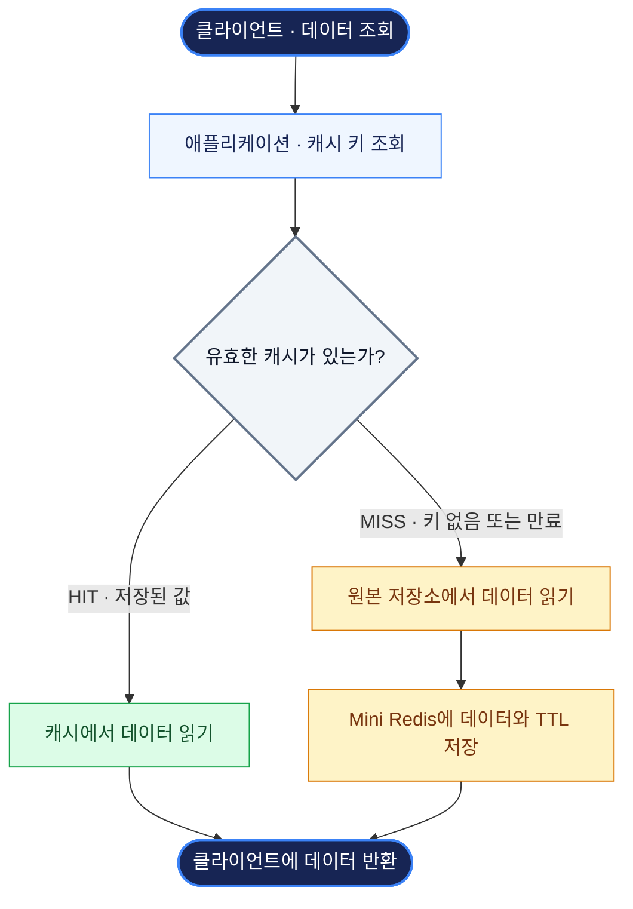
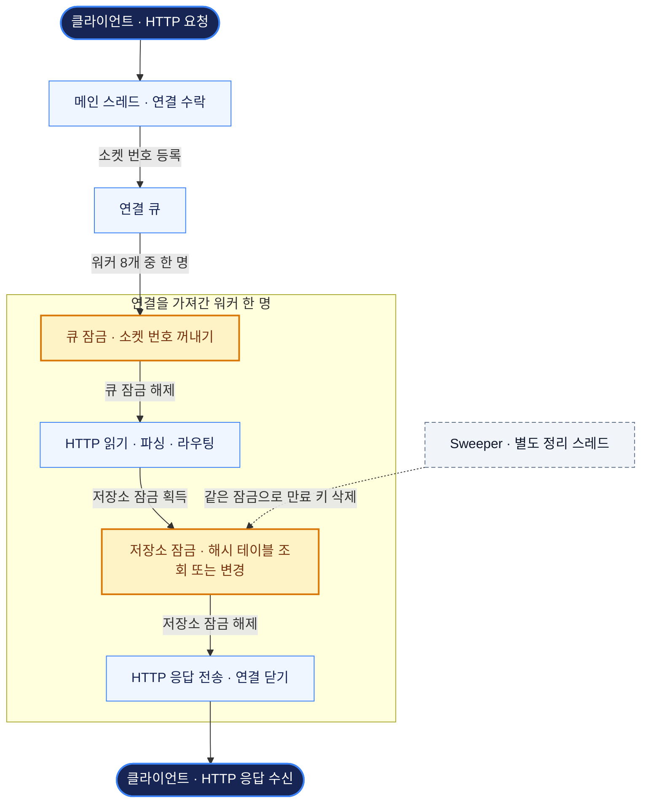

# Mini Redis

**C로 구현한 HTTP 기반 인메모리 키-값 저장소**

크래프톤 정글에서 해시 테이블, TTL 만료 처리, 멀티스레드 HTTP 서버를 구현했습니다. 별도의 상품 API에 캐시를 연결해 저장소가 실제 요청을 처리하는 과정과 캐시 적용 효과를 확인했습니다. [팀 소스코드](https://github.com/eunah08/week-11-12/tree/6a5eab5)

- **서버 구성** · 워커 8개가 큐에서 연결을 꺼내 HTTP 요청을 처리
- **HTTP API** · 키 관리와 서버 상태 확인을 위한 엔드포인트 9개
- **캐시 성능** · 같은 상품 반복 조회 시 평균 응답 시간 **303.5ms → 11.1ms**

[빠른 시작](#빠른-시작) · [전체 요청 흐름](#전체-요청-흐름) · [핵심 구현](#핵심-구현) · [구현 차이점](#구현-차이점) · [HTTP API](#http-api) · [성능 측정](#성능-측정)

---

## 팀 협업 방식

- **공통 협약과 개별 구현** — 먼저 코드 협약을 정한 뒤, 팀원 각자가 같은 기능을 구현했습니다. 서로의 코드를 비교해 SK 구현을 기반으로 삼고, 세 팀원(EA·SK·JK)이 작성한 테스트를 모아 통합본을 검증했습니다. [공통 코드 협약](docs/미니레디스_협약.md) · [구현 통합 기록](docs/implementation_notes.md)
- **3시간마다 코어타임** — 각자의 진행 상황과 막힌 지점을 공유했습니다. 같은 코드를 다르게 해석한 부분은 질문을 주고받으며 실행 순서를 함께 짚었습니다.
- **코드로 학습하고 문제로 점검** — 통합한 코드에서 각 개념이 쓰이는 지점을 따라갔습니다. 한 주제가 끝나면 실행 흐름을 묻는 문제를 직접 만들어 함께 풀고, 답이 갈린 부분을 확인한 뒤 다음 학습 계획을 정했습니다.

## 전체 요청 흐름

애플리케이션은 데이터를 조회할 때 Mini Redis에서 해당 키를 먼저 찾습니다. 캐시가 비어 있거나 만료되면 원본 저장소에서 읽고, TTL과 함께 캐시에 저장합니다.



### 예시 · 42번 상품을 조회하고 수정하기

| 사용자 행동 | 원본과 캐시에 일어나는 변화 | 사용자가 받는 결과 |
|---|---|---|
| ① 30,000원짜리 상품을 처음 조회 | 상품 API가 원본을 읽고 `product:42`에 상품 정보를 저장합니다. | 30,000원 · MISS |
| ② 만료 전에 다시 조회 | 캐시에서 상품을 찾습니다. 원본 조회를 생략합니다. | 30,000원 · HIT |
| ③ 가격을 32,000원으로 수정 | 상품 API가 원본 가격을 바꾸고 기존 캐시 키를 삭제합니다. | 갱신한 상품 정보 |
| ④ 수정 후 처음 조회 | 캐시가 비어 있으므로 원본의 새 가격을 읽어 캐시를 다시 채웁니다. | 32,000원 · MISS |

③의 삭제를 **캐시 무효화**라고 합니다. 이전 가격으로 응답하는 일을 막기 위한 처리입니다. TTL 만료 역시 다음 조회에서 캐시를 다시 채우는 계기가 되지만, 만료 자체가 원본 가격을 바꾸지는 않습니다. [상품 조회·수정 구현](src/demo/sample_api.c) · [Mini Redis HTTP 클라이언트](src/client/mini_redis_client.c)

## 핵심 구현

| 구현 영역 | 적용한 방식 | 소스 |
|---|---|---|
| 해시 테이블 | **FNV-1a**로 버킷을 찾고, 충돌한 키는 연결 리스트에서 비교합니다. 항목이 늘어나면 버킷을 확장하고 재해싱합니다. | [hash_table.c](src/store/hash_table.c) |
| 키-값 저장소 | 저장·조회·삭제와 키 존재 확인을 지원합니다. 접두사로 여러 키를 삭제하고 조회 통계를 확인할 수 있습니다. | [store.c](src/store/store.c) |
| TTL과 만료 정리 | 키에 만료 시각을 기록합니다. 접근 시 만료 여부를 확인하고, **Sweeper**가 남은 만료 항목을 주기적으로 정리합니다. | [store.c](src/store/store.c) · [sweeper.c](src/server/sweeper.c) |
| HTTP 서버 | 메서드와 경로에 맞는 핸들러를 선택합니다. 본문이 필요한 요청은 JSON을 검증한 뒤 저장소 연산 결과를 HTTP 응답으로 반환합니다. | [router.c](src/server/router.c) · [handlers.c](src/server/handlers.c) |
| 상품 캐시 | 캐시에 값이 없으면 원본에서 읽어 캐시를 채웁니다. 상품을 수정하면 기존 캐시 키를 삭제합니다. | [sample_api.c](src/demo/sample_api.c) |
| 워커 풀과 동시성 | **워커 8개**가 큐에서 연결을 꺼내 각자 응답까지 처리합니다. 큐와 저장소를 서로 다른 뮤텍스로 보호합니다. | [tcp_server.c](src/server/tcp_server.c) |

[구현별 상세 표와 소스 코드 보기](docs/mini-redis-implementation.md)

## 구현 차이점

### 워커 풀과 동시성

이 프로젝트의 구현 차이점은 **클라이언트 연결의 요청 처리 단위를 워커에 맡긴 구조**입니다. Redis Open Source는 일반적인 명령을 메인 스레드에서 순차 실행하며, 네트워크 I/O에는 별도 스레드를 사용할 수 있습니다. 이 프로젝트는 메인 스레드가 받아들인 연결을 큐에 넣고, **워커 8개가 각자 연결을 꺼내 HTTP 요청 읽기부터 응답 전송까지** 맡습니다. [Redis 명령 실행 방식](https://redis.io/docs/latest/operate/oss_and_stack/management/optimization/latency/) · [Redis 8.0 I/O 스레딩](https://redis.io/docs/latest/operate/oss_and_stack/stack-with-enterprise/release-notes/redisce/redisos-8.0-release-notes/) · [Mini Redis 워커 구현](src/server/tcp_server.c)

한 워커가 느린 클라이언트의 데이터를 기다리는 동안 다른 워커는 자기 연결의 요청을 처리할 수 있습니다. 여러 워커가 공유 해시 테이블에 접근하는 구간에는 저장소 잠금을 걸어 한 번에 한 워커만 사용하게 합니다. 아래 흐름도는 연결 하나를 맡은 워커가 어느 단계에서 잠금을 얻고 놓는지 보여줍니다.



### 동시성 구현

| 구현 항목 | 보호하는 데이터와 동작 |
|---|---|
| 연결 큐와 조건 변수 | 메인 스레드가 수락한 소켓 번호를 큐에 넣고 대기 중인 워커에 신호를 보냅니다. 큐 잠금은 등록·인출 중 큐 상태를 보호합니다. |
| 워커 풀 | 8개 워커가 각자 연결을 꺼내 요청 읽기부터 응답까지 담당합니다. 큐 잠금을 푼 뒤 소켓을 읽으므로 다른 워커도 연결을 가져갈 수 있습니다. |
| 공유 저장소 잠금 | 요청 핸들러와 Sweeper는 같은 뮤텍스를 사용합니다. 값을 조회할 때는 잠금 안에서 복사하고, 응답 전송은 잠금을 푼 뒤 진행합니다. |
| 서버 종료 | 새 연결 수신을 마치고 워커 종료를 기다립니다. 이어 Sweeper를 깨워 종료시키고 저장소와 잠금 자원을 해제합니다. |

### 연결 하나를 맡은 워커의 흐름

1. 메인 스레드가 연결을 수락하고 소켓 번호를 큐에 넣습니다. 대기하던 워커가 깨어나 큐에서 번호를 꺼내고 큐 잠금을 풉니다.
2. 이 워커가 소켓에서 HTTP 요청을 읽습니다. 상품 API가 캐시를 채우는 저장 요청이라면 경로에서 키를 얻고, 요청 본문의 값을 검증한 뒤 저장소 잠금을 획득합니다.
3. 워커는 `product:42`를 저장하고 잠금을 풉니다. 이어서 클라이언트에 생성 여부를 응답하고 연결을 닫습니다.
4. 워커는 큐를 다시 확인합니다. 다음 연결이 있으면 처리하고, 비어 있으면 기다립니다. 이후의 조회는 새 연결이므로 다른 워커가 맡을 수도 있습니다.

### 예시 · 여러 워커가 연결을 처리하는 순간

| 워커 | 가능한 실행 장면 |
|---|---|
| W1 | 느린 클라이언트가 본문을 마저 보내기를 기다립니다. 큐와 저장소 잠금은 이미 다른 워커가 사용할 수 있습니다. |
| W2 | 저장소 잠금을 잡고 상품 가격을 기록합니다. |
| W3 | 다른 상품의 조회 요청을 읽었지만, W2가 보유한 저장소 잠금을 기다립니다. |
| W4 | 앞선 조회에서 복사한 값으로 응답을 전송합니다. 이 작업에는 저장소 잠금이 필요하지 않습니다. |
| W5~W8 | 큐가 비어 있어 다음 연결을 기다립니다. |

W2가 잠금을 풀면 대기 중인 스레드가 저장소에 들어갈 수 있습니다. 획득 순서는 실행마다 달라질 수 있습니다. 워커 8개가 모두 연결을 맡고 있다면, 큐에 들어온 다음 연결은 워커가 돌아올 때까지 기다립니다. [연결 큐와 워커 루프](src/server/tcp_server.c) · [요청별 잠금 범위](src/server/handlers.c)

### 잠금을 둘로 나눈 이유

큐 잠금은 **다음 연결을 누가 가져가는지**를 보호합니다. 번호 하나를 꺼낸 뒤에는 잠금을 풀기 때문에, 한 클라이언트가 요청을 천천히 보내도 다른 연결을 꺼낼 수 있습니다. 큐가 빈 동안에는 조건 변수로 기다리며 큐 잠금을 내려놓습니다.

저장소 잠금은 **여러 실행 흐름이 같은 해시 테이블을 다루는 구간**을 보호합니다. 예를 들어 조회 중인 값을 Sweeper가 만료 처리할 수 있으므로, 조회 핸들러는 잠금 안에서 값의 복사본을 얻습니다. 잠금을 풀고 나면 원래 항목이 삭제돼도 복사본으로 응답을 끝낼 수 있습니다. 이 덕분에 네트워크 전송이 끝날 때까지 다른 요청의 저장 작업을 미룰 필요가 없습니다. [저장소 잠금과 응답 생성](src/server/handlers.c) · [만료 정리](src/server/sweeper.c)

## HTTP API

| 메서드와 경로 | 용도 | 응답에서 확인할 내용 |
|---|---|---|
| `PUT /keys/{key}` | 값 저장 또는 교체 | `created` |
| `GET /keys/{key}` | 값 조회 | `value` |
| `DELETE /keys/{key}` | 키 삭제 | `deleted` |
| `GET /keys/{key}/exists` | 키 존재 여부 확인 | `exists` |
| `PUT /keys/{key}/ttl` | TTL 설정 | `applied` |
| `GET /keys/{key}/ttl` | 잔여 시간 조회 | `ttlMs` |
| `POST /invalidate` | 접두사가 일치하는 키 삭제 | `deletedCount` |
| `GET /stats` | 저장소 통계 조회 | 항목 수와 적중·실패·만료 횟수 |
| `GET /health` | 서버 상태 확인 | 서버의 정상 응답 여부 |

## 빠른 시작

### 시각화 웹페이지 실행

웹페이지가 포함된 `Redis-develop` 브랜치의 저장소 루트에서 실행합니다.

**Linux** · C 컴파일러, `make`, `python3`가 설치된 환경에서 실행합니다. `make run`이 서버를 빌드한 뒤 실행합니다.

```sh
make run
```

**macOS** · Docker Desktop을 켠 뒤 저장소 루트에서 실행합니다.

```sh
docker run --rm -it \
  -p 127.0.0.1:6380:6380 \
  -v "$PWD:/project:ro" \
  -w /project ubuntu:24.04 \
  bash -c 'apt-get update && apt-get install -y build-essential python3 && make BUILD_DIR=/tmp/mini-redis-build && exec /tmp/mini-redis-build/mini_redis'
```

서버가 시작되면 브라우저에서 [http://localhost:6380/](http://localhost:6380/)을 엽니다. 시각화 화면에서 상품명과 가격을 보내면 **연결 큐 → 워커 → 공유 저장소 → 응답** 순서가 재생됩니다. 화면의 상품 등록은 브라우저에서 동작하는 시뮬레이션입니다. [시각화 화면 소스](src/server/visualization.html)

### 예시 · 실제 HTTP API로 값 저장하고 조회하기

서버를 켜 둔 상태에서 다른 터미널을 열어 키 하나를 저장하고 조회합니다.

```sh
curl -sS -X PUT 'http://127.0.0.1:6380/keys/product%3A42' \
  -H 'Content-Type: application/json' -d '{"value":"30000"}'

curl -sS 'http://127.0.0.1:6380/keys/product%3A42'
```

첫 요청은 키를 새로 만들었는지 응답합니다. 두 번째 요청은 저장된 값 `{"value":"30000"}`을 반환합니다. 주소의 `%3A`는 콜론을 인코딩한 표기이며, 두 요청 모두 저장소에서 `product:42`를 사용합니다.

## 테스트

저장소 루트에서 목적에 맞는 명령을 실행합니다.

| 명령 | 검증 범위 |
|---|---|
| `make test` | 해시 충돌, 키 저장·조회·삭제, TTL 만료 경계, 메모리 할당 실패, HTTP·JSON 처리, Sweeper 동작 |
| `make test-asan` | AddressSanitizer와 UBSan을 적용한 단위 테스트 |
| `make test-api` | 실행 중인 서버에 HTTP 요청을 보내 API 동작과 여러 클라이언트의 동시 접근 검증 |
| `make test-demo` | 상품 API와 Mini Redis를 연결한 캐시 시나리오 검증 |
| `make test-all` | 위 네 가지 테스트 묶음 실행 |

만료 경계 테스트에서는 가짜 시계를 사용합니다. 같은 키가 **만료 1ms 전에는 조회되고 만료 시각에 도달하면 사라지는지** 실제 시간을 기다리지 않고 확인합니다. [만료 경계 테스트](tests/store/test_store_edge_cases.c) · [동시성 테스트](tests/api/test_concurrency.py)

## 성능 측정

원본 조회 지연을 300ms로 설정하고, 시나리오마다 빈 캐시에서 200건을 요청한 팀 측정 결과입니다. 첫 요청은 단독으로 보내고 이후 동시 요청 수는 10으로 설정했습니다. 평균 응답 시간은 첫 요청을 제외한 199건 기준이며 원본 조회 횟수는 200건 전체 기준입니다.

| 요청 패턴 | 캐시 OFF → ON 평균 응답 시간 | 원본 조회 횟수 OFF → ON |
|---|---:|---:|
| 같은 상품 반복 | 303.5ms → 11.1ms | 200 → 1 |
| 100개 상품 중 무작위 조회 | 304.1ms → 153.0ms | 200 → 100 |
| 매번 새로운 상품 조회 | 303.5ms → 303.9ms | 200 → 200 |

같은 상품을 반복하면 첫 조회 이후 원본 접근을 생략할 수 있습니다. 매번 다른 상품을 조회한 경우에는 모든 요청이 원본까지 도달해 평균 응답 시간이 거의 같았습니다. 재측정 명령은 `make bench`이며, 저장소의 해시 테이블 연산은 `make bench-store`로 별도 측정합니다. [측정 환경과 전체 결과](docs/benchmark.md)

## 디렉터리 구조

| 경로 | 이곳에서 확인할 내용 |
|---|---|
| [src/store](src/store/) | 해시 테이블, 키-값 연산, TTL에 쓰는 시계 |
| [src/server](src/server/) | 연결 큐와 워커 풀, HTTP 처리, 만료 정리 스레드 |
| [src/client](src/client/) · [src/demo](src/demo/) | Mini Redis를 호출하는 HTTP 클라이언트와 상품 API |
| [tests](tests/) | 엔진 단위 테스트, 외부 HTTP API 및 캐시 통합 테스트 |
| [bench](bench/) · [docs](docs/) | 성능 측정 스크립트와 결과, 코드 협약과 통합 기록 |
